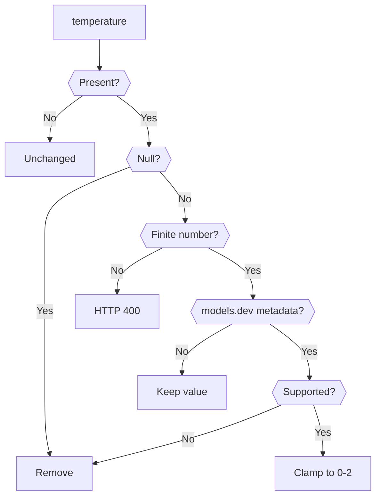
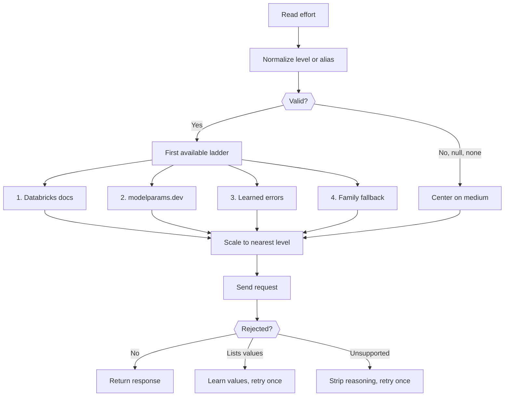

# Connect model clients to Databricks

Use the model gateway when an OpenAI, Anthropic, embedding, or Codex client must
call models available in a Databricks workspace.

## Choose a gateway mode

Use the foreground CLI for one local session:

```bash
dbx model-gateway \
  --profile <profile> \
  --listen tcp://127.0.0.1:4000
```

Select `auto` when the gateway should choose both the concrete model and
reasoning budget for the current user turn:

```bash
curl http://127.0.0.1:4000/v1/responses \
  -H 'content-type: application/json' \
  -d '{
    "model": "auto",
    "input": "Refactor the authorization layer across the repository"
  }'
```

`auto` also works with Chat Completions and Anthropic Messages. It is not valid
for embeddings. Concrete model ids, model-class headers, and explicit reasoning
fields remain authoritative.

Install the current-user service when local tools need the endpoint after the
terminal closes:

```bash
dbx model-gateway service install --profile <profile>
dbx model-gateway service status
```

Register the AppKit plugin when model routes belong to a Databricks App:

```ts
import { server } from "@databricks/appkit";
import { appkit } from "@dbx-tools/appkit";
import { modelGateway } from "@dbx-tools/appkit-model-gateway";

await appkit.createApp({
  plugins: [server(), modelGateway()],
});
```

The standalone base URL is [http://127.0.0.1:4000/v1](http://127.0.0.1:4000/v1).
The default embedded
base path is `/api/model-gateway/v1`.

## Call an OpenAI-compatible route

List models:

```bash
curl http://127.0.0.1:4000/v1/models
```

Send a Responses request:

```bash
curl http://127.0.0.1:4000/v1/responses \
  -H 'content-type: application/json' \
  -H 'x-dbx-tools-model-class: chat-balanced' \
  -d '{
    "input": "Explain this repository in three sentences."
  }'
```

The gateway resolves loose model names and capability classes against the live
workspace catalogue. An exact serving endpoint or `system.ai.*` service name
wins over automatic selection.

## Understand request parameter translation

The gateway translates parameters only when it has provider-safe metadata or a
specific Databricks error response. Unknown custom endpoints keep valid numeric
sampling values unchanged.

### Temperature translation

The following flow shows how the gateway handles `temperature`.



Temperature support comes from the Databricks provider records in the committed
models.dev snapshot. The daily metadata refresh keeps the previous cached or
committed snapshot when models.dev is unavailable.

### Reasoning translation

The following flow shows how the gateway maps reasoning effort and retries a
Databricks request.



The reasoning ladder uses Databricks documentation first, then modelparams.dev
effort enums, learned Databricks error values, and family defaults. A
provider-specific boolean such as Qwen `enable_thinking` does not define a
generic effort ladder. If Databricks reports that the model does not support the
reasoning field, the gateway removes the field and retries once.

## Use Anthropic, embeddings, or Codex

The gateway also serves:

- Anthropic Messages.
- OpenAI-compatible embeddings.
- Codex model discovery and Responses traffic.
- OpenAI Chat Completions.

Configure Codex with `wire_api = "responses"` and
`supports_websockets = false`. Codex requests advertise their client identity
and receive a compatible model catalogue.

## Choose model policy

Use `model` for an exact or fuzzy name. Use `modelClass` for a capability band
such as `chat-fast` or `chat-thinking`.

Set `preferSystemModels` or pass `--prefer-system-models` to prefer eligible
`system.ai.*` services for non-exact Responses requests. Exact names remain
authoritative.

Use model overrides only to correct workspace metadata for a known model. For
example, disable web search when the selected gateway route cannot use an
advertised capability.

## Understand automatic routing

Automatic routing calls Databricks System One with token-budgeted recent text,
tool names, protocol, and required capabilities. The budget prioritizes the
current request and then fills remaining space from the newest prior user and
assistant messages. It never sends credentials, tool arguments, image bytes, or
unbounded conversation history. System One chooses a logical tier and reasoning
budget; `@dbx-tools/model` resolves the concrete live endpoint.

With `automaticPreferCostEfficientModels` enabled (the default), resolution
prefers lower published Databricks cost scores within the selected tier. When
cost does not distinguish candidates, the model package's centrally owned
open-weight policy is preferred before normal quality/version order. Protocol,
capability, requested reasoning, lifecycle, and tier constraints are always
applied first.

Selections are pinned through tool calls and retries with AppKit's shared cache.
In a Databricks App, the cache reuses configured Lakebase/PostgreSQL persistence.
The storage contract is injectable, so another runtime can provide SQLite or a
different key-value backend without changing routing policy.

If the selector times out, fails, or returns confidence below the configured
minimum, the gateway uses a deterministic compatible fallback. Inspect these
response headers for the result:

- `x-dbx-tools-selected-model`
- `x-dbx-tools-auto-tier`
- `x-dbx-tools-auto-reasoning-effort`
- `x-dbx-tools-auto-confidence`
- `x-dbx-tools-auto-reason-code`
- `x-dbx-tools-auto-source`
- `x-dbx-tools-auto-degraded`

## Understand protocol limits

The gateway uses direct streaming when the selected model supports the client
protocol. It uses Vercel AI SDK translation when protocols differ.

The Responses API rejects stateful options that cannot be preserved, including
`previous_response_id`, `store: true`, and `background: true`.

Web search and custom tools require a model that advertises the corresponding
capability.

## <a id="additional-resources"></a> Additional resources

- [@dbx-tools/appkit-model-gateway](../packages/js/node/appkit-model-gateway/README.md)
- [@dbx-tools/shared-model-gateway](../packages/js/shared/model-gateway/README.md)
- [@dbx-tools/model](../packages/js/node/model/README.md)
- [@dbx-tools/cli](../packages/js/cli/dbx-tools/README.md)
